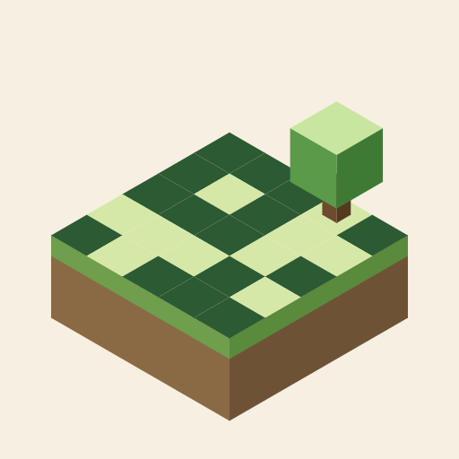
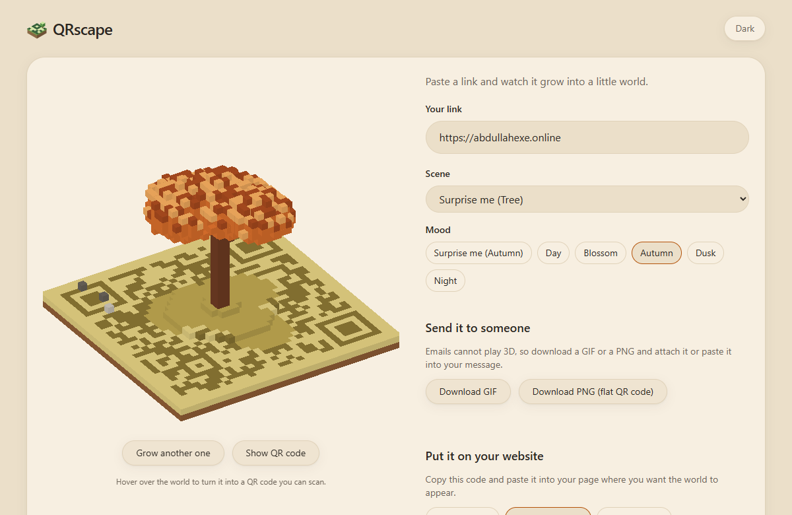
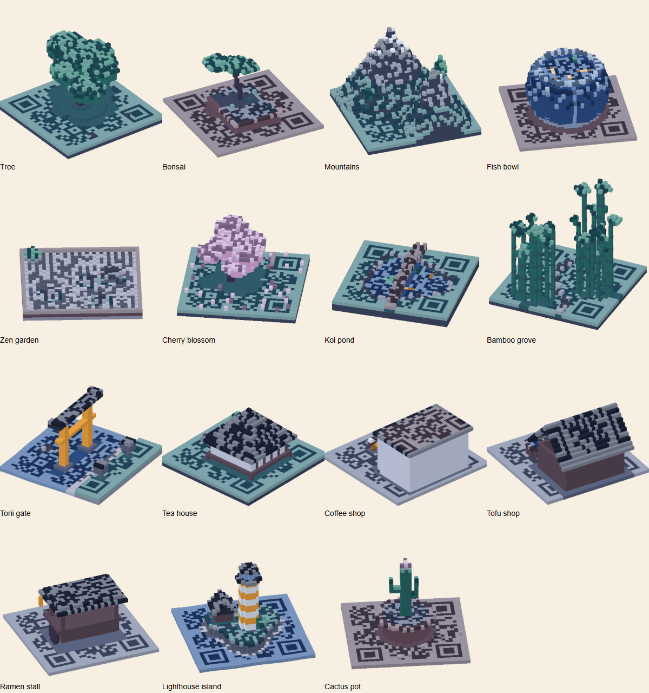
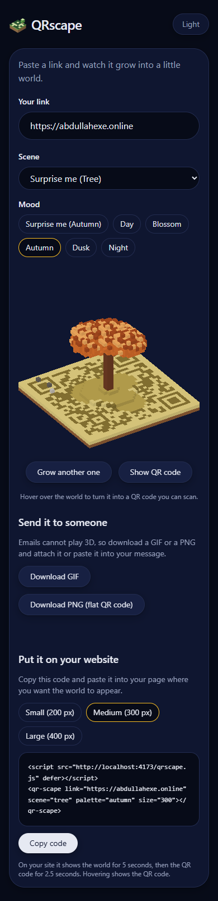

<p align="center"></p>

<h1 align="center">QRscape</h1>

<p align="center"><b>Turn any link into a tiny 8-bit world that is also a QR code.</b></p>

Paste a link and QRscape grows a calm voxel world from it: a tree, a bonsai, a koi pond, a ramen stall and 11 more.
Look at it from the side and it is a little world. Look straight down and it is a QR code you can scan. Every
link grows its own world, like a seed in Minecraft. Send it as a GIF, or paste one line of code into your website.
Free and private: it runs entirely in your browser. No account, no server, nothing stored.

**Live:** https://qrscape-ten.vercel.app · **Version:** 0.1.0

[](https://github.com/4bdulllahh/qrscape/actions/workflows/ci.yml)
[](https://qrscape-ten.vercel.app)
[](LICENSE)

<p align="center"></p>

> The links in these screenshots are examples.

## Features

- **Every link grows its own world.** The link is turned into a number (a seed) that picks the scene, the mood and every detail: branch shapes, peak heights, where the fish swim. The same link always grows the same world.
- **15 calm scenes.** Tree, bonsai, mountains, fish bowl, zen garden, cherry blossom, koi pond, bamboo grove, torii gate, tea house, coffee shop, tofu shop, ramen stall, lighthouse island and cactus pot.
- **5 moods.** Day, Blossom, Autumn, Dusk and Night. Let the link choose, or pick your own.
- **Grow another one.** Not your favourite? Grow a new world from the same link.
- **A QR code hiding in plain sight.** Hover over the world and it turns smoothly into a flat QR code. Every scene in every mood is checked to scan.
- **For email and chat.** Download a looping GIF (the world, then the QR code) or a flat PNG of the QR code in the world's colours.
- **For your website.** Copy one short piece of code, in small, medium or large. On your page the world shows for 5 seconds, then the QR code for 2.5 seconds, and hovering shows the QR code.
- **Light and dark.** A calm sand and navy look that follows your system.

| All 15 scenes (Night mood)                                      | On a phone                                                          |
| --------------------------------------------------------------- | ------------------------------------------------------------------- |
|  |  |

## Getting started

1. Open https://qrscape-ten.vercel.app.
2. Paste your link.
3. Pick a scene and mood, or keep the surprise.
4. Download a GIF or PNG, or copy the code for your website.

## Privacy

Nothing leaves your browser. There is no account, no server and no tracking. Your link is only used to draw the
world and the QR code on your own device.

## For developers

```
npm install
npm run dev        # http://localhost:5173
npm run check      # lint, format check, typecheck, tests, build (same as CI)
```

Vite, React 19, TypeScript and plain three.js, with Tailwind 4 and vitest. Pure logic (seed, QR, scenes, palettes)
lives in `src/domain/` and is fully tested; `src/scene/` draws it; `src/embed/` is the website widget. Browser
checks in `scripts/` decode every scene and every export with a real QR reader. See [handover.md](handover.md)
for the full picture.

## License

[MIT](LICENSE) · Made by [Abdullah](https://abdullahexe.online)
